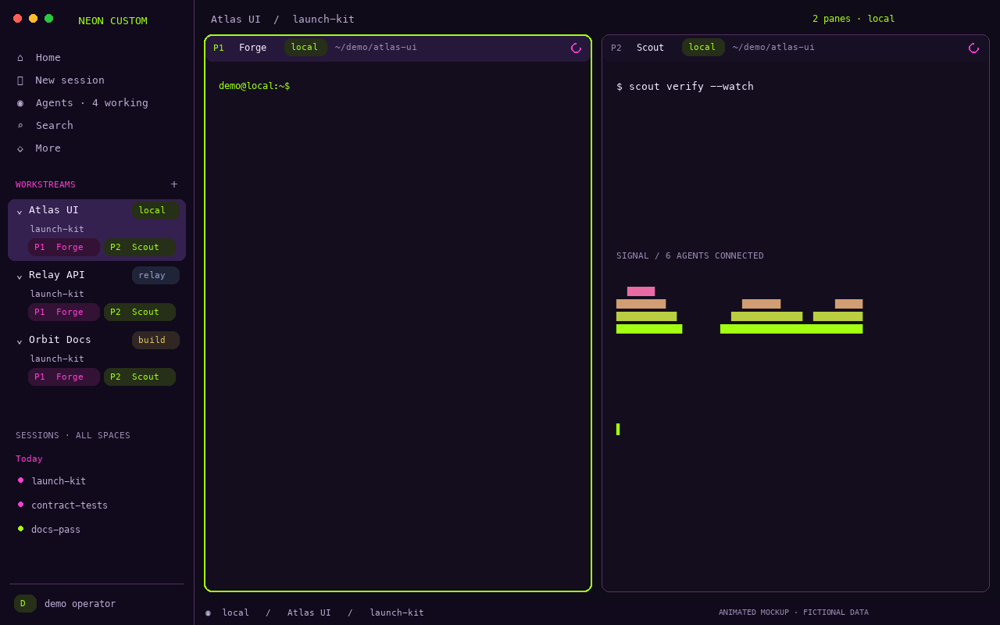

# Neon Custom

```console
$ herdr-app do layout.switch '{"name":"neon-custom"}'
```

Dark violet, acid green and hot pink. Workstreams unfold into sessions and pane cards, so side-by-side agents each have a place in the sidebar.



[Watch the MP4](assets/demo.mp4) · [Still preview](preview.png)

The demo uses fictional machines, agents and projects. Typing, ASCII art and signal bars are scripted terminal content inspired by [my profile](https://github.com/jpisgeek/jpisgeek); they are not built-in agent output. The layout animates status indicators and attention pulses. Background artwork is static.

## What you get

- Workstreams → sessions → individual pane cards. Split a session and both agents stay visible.
- Matching P1/P2 labels in the sidebar and terminal headers.
- Machine chips on workstreams, sessions, pane headers and the status bar.
- Full-width working area, with Files and Changes available when you need them.
- Live agent sessions stay under Today across workstreams. The session filter says whether you are seeing all spaces or just one.
- Working indicators spin or pulse; blocked and done states draw attention until you inspect them.
- Home composer, agent picker, remote machine selection, and optional Home/Work shortcuts.

## Install

```sh
git clone https://github.com/jpisgeek/neon-custom.git
cd neon-custom
sh install.sh
```

The installer refuses to overwrite an existing layout and leaves your keybindings alone. See [INSTALL.md](INSTALL.md) for setup and customization.

[RECIPE.md](RECIPE.md) describes the layout and how to rebuild it. [DEMO.md](DEMO.md) describes the mock animation and how it was generated.

Also available: [Nightwire](https://github.com/jpisgeek/nightwire).
