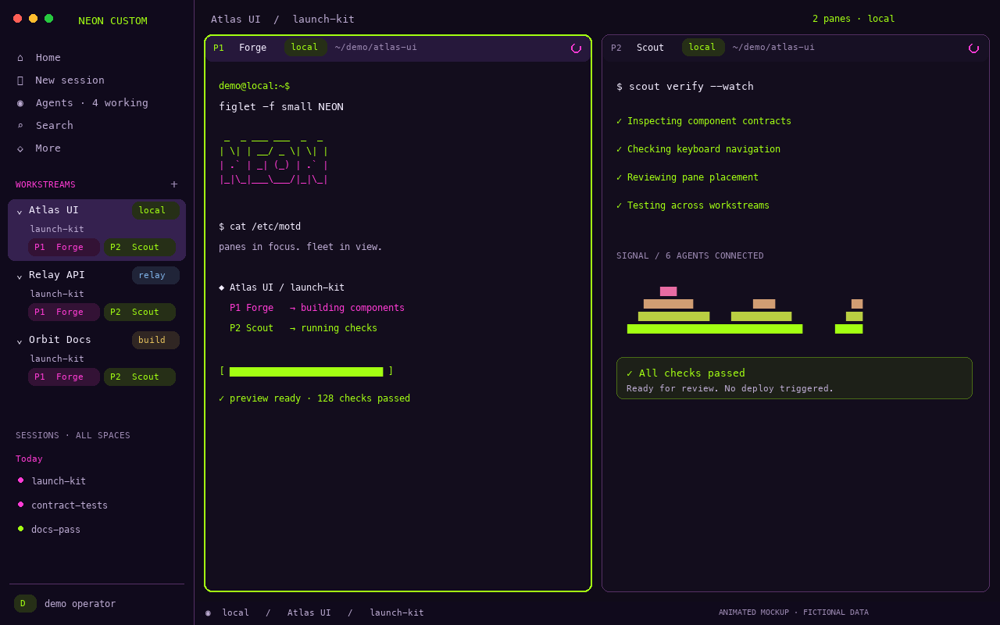

# Neon Custom

A dark violet Herdr window for working across several machines. A left sidebar
lists workstreams with their sessions nested under them, then every session by
time. A colour-coded machine chip marks every workstream, session, pane header
and the status bar. The work area shows the active tab's panes as rounded cards,
or a home screen with a composer over a pink-to-green halftone.

## What you see

Left to right, then top to bottom. Theme `neon-custom`: background
`#100b19`, canvas `#08050e`, chrome `#100a1c`, foreground `#f3edff`, muted
`#bcabd2`, dim `#9c89b2`, selected `#35214f`, hover `#281b3c`, border `#563166`,
accent / solid / done `#a3ff12` (acid green), working `#ff3bd4` (hot pink),
blocked `#ff799d`. Hot pink `#ff3bd4` also draws section headers, the 2 px
window divider and the focused pane's border. No system title bar. macOS
traffic lights at 16, 15.

**Sidebar** (268 px, 44–460, chrome), four copies of the sidebar mod:

- **Head** (46 px, drags the window): sidebar toggle, "NEON CUSTOM" (11 px
  semibold, pink), previous and next workstream chevrons, and window buttons where
  the system draws none.
- **Nav** (156 px): Home, New session, Agents (reads "Agents · 2 working", with an
  accent count when agents need you), Search, More. Rows 30 px, 13 px text.
- **List** (fills, scrolls):
  - **WORKSTREAMS** header with **+**. One 30 px row per workstream: fold
    chevron, an 18 px letter mark in the workstream's colour, its name, a
    machine chip, a red dot when that machine is not answering, its branch (when
    not main/master), a status dot, and how long since it last changed. Folded,
    it shows its session count. Open, its sessions follow in tab order on a 1 px
    guide line: 26 px rows, 12.5 px text, status dot, name, age.
  - **SESSIONS** header with a filter (this workstream only, or all) and **+**.
    Sessions by last change in folds: Today, Last 7 days, Last 30 days, Older,
    and "Settled · N". Each 28 px row: status dot, a 14 px workstream mark, the
    name, a machine chip, the age.
- **Foot** (60 px): a 22 px acid-green avatar with the first letter of the home
  folder's name, that name, an accent dot when agents need you, the Settings
  gear (with a dot when an app update is ready).

**Machine chip**: a 16 px pill, 9.5 px Geist Mono semibold, the machine's colour
on a 15 % wash of it. Defaults: this computer is "local" in `ansi2`. Other machines
show their own name in a colour picked from it (`ansi4`, `ansi3`, `ansi6`,
`ansi12`, `ansi11`, `ansi14`). The `MACHINES` map in `machine.js` sets short
names, colours and this computer's host name.

**Work area** (stack, padding 10): the active tab's panes as cards (gap 8,
radius 10, 1 px `#8f39b5` border, 2 px pink border when focused, framed even
when alone). Each card has a 30 px header: program icon, name, machine chip,
folder (dim), a pink spinner while working, a "Needs you" badge when blocked, a
green dot when done. Split right, split down, zoom and close show on hover.

**Home** (the stack's other child): `halftone-pink-green.png` as a cover
background, "What should we work on?", and a composer: a text box, an agent pill
(installed agents on the target machine, plus Shell), a folder chip, a machine
chip, and an acid-green start button.

**Files / Changes panel** (368 px, 280–900, hidden until opened): Herdr's
`files` and `changes` mods.

**Status bar** (30 px, canvas, pink top border, 10.5–11.5 px): a monitor or
server icon, the machine chip and host name, the branch. Then the agent count
with a dot ("3 agents · 1 need attention"), a Files | Changes switch, and the
command palette's key ("⌘⇧P commands").

Pane cards beneath sessions show each split pane separately with P1/P2 labels, agent identity, folder and status. Selecting a card opens its space/session and focuses the pane. Header numbers use the same pane ordering. This version has no fleet panel on the right or top.

## How it behaves

- **Statuses.** Working pulses pink (dots) or spins (pane header). Blocked shows
  in `#ff799d` with a "Needs you" badge. Done is acid green and turns idle once
  seen. Idle is dim. A workstream's dot is its most urgent session's.
- **Needs you stands out.** A blocked agent's rows (its session in both lists,
  its workstream, its rail icon) get a 2 px outline in the blocked colour over a
  faint wash, pulsing between 25 % and full opacity every 900 ms. Its pane
  header band pulses the same way (a 25 % wash and a 2 px bottom line). An agent
  that finished while you were away does the same in acid green until you look.
  The status bar's dot grows to 7 px and pulses with "· N need attention". All of
  it is native `loop("opacity")` animation, no timers.
- **Workstreams.** Click selects it and shows the work area. Drag to reorder
  within its machine. Right-click opens Herdr's space menu. The chevron folds
  its sessions, and folds are remembered.
- **Workstreams +** opens a popup, "NEW WORKSTREAM ON": this computer, then each
  machine, with chip and host name. Pick one to create a workstream there.
  "connecting" or a red "not answering" machine can't be picked.
- **Sessions.** Click selects its workstream and tab. Double-click renames.
  Right-click opens Herdr's tab menu. Hover swaps the age for settle (or
  restore) and close buttons. The same session shows under its workstream and in
  the list by time.
- **Session names.** A given name wins. An unnamed shell reads
  `<shell> · <folder>`: `~` for home, only the last two folders of a deep path
  (`…/repo/branch`). Otherwise the terminal's title unless it is a path, else
  the tab number.
- **Rail.** The sidebar toggle (or dragging the sidebar under 208 px) collapses
  it to an icon rail (76 px on macOS, 44 px elsewhere). Toggling again restores
  the last width.
- **Nav.** Home shows the home screen. New session opens Herdr's `new-menu`.
  Agents opens the agent list (420 × 560 dialog: grouped by space or by
  priority, Needs you / Working / Done / Idle, pinned first). Search opens
  Herdr's `picker`. More opens a popup with the Files and Changes panels, Close
  the panel, Toggle sidebar, Settings, Shortcuts, What's new, Add machine, and
  the window's minimize, maximize and close.
- **Home composer.** Enter starts a session. The pill picks the agent
  ("START A SESSION WITH"), the machine chip picks the machine ("START SESSIONS
  ON", with "Add machine…"), the folder chip picks a local folder. On the
  current workstream's machine it opens a new tab there. On another machine it
  opens a new workstream. The session is named from the first words typed.
- **Keys** (optional, `keys.neon-custom.json`): Cmd-Shift-H home screen,
  Cmd-Shift-J work area.

Live-agent tabs are always placed in Today. The session header labels its current filter: All spaces or This space. Working spinners and attention pulses are native; the terminal animation in assets/demo.gif is fictional scripted content.

## Built from

- **Layout** `neon-custom`: root row (`titlebar: none`, divider 2 px
  `#ff3bd4`, `terminal_padding` [16, 20]) → `sidebar` column (blocks
  `sidebar-head`, `sidebar-nav`, `sidebar-lists`, `sidebar-footer`, each the
  sidebar mod with `props.part` `head`, `nav`, `list`, `foot`) and
  `work-column` → `work-body` row (`main-stack` stack with `work`
  `{tab: "active"}` and `home`, plus a hidden `panel` column with `panel-body` stack of
  `files` and `changes`) and the `status` block.
- **Mods:**
  - `neon-custom-sidebar`: head, nav, list and foot, and also the **+**
    popup, opened as `openOverlay({mod: "neon-custom-sidebar", kind:
    "popup", props: {part: "machines"}})`.
  - `neon-custom-status`: the status bar.
  - `neon-custom-pane`: the pane header (a clone of Herdr's `pane`).
  - `neon-custom-home`, with popups `neon-custom-agents` and
    `neon-custom-machines`.
  - `neon-custom-agent-list` (a clone of Herdr's `agents`) and
    `neon-custom-more`.
  - `machine.js` in sidebar, status and pane: the `MACHINES` map, `machineOf`,
    `machineInfo` and `machineChip`.
- **Herdr's own mods used:** `files`, `changes`, `menu`, `new-menu`, `picker`,
  `machine-add`, and icons from `workspace-chrome`, `tabs`, `pane` and `files`.
- **`herdr` API:** `spaces`, `panes`, `agents`, `machines`, `focused`,
  `layout`, `theme`, `shared` / `setShared`, `openOverlay` / `closeOverlay`,
  `knownAgents`, `pickFolder`, `nextCommand`. Commands `space.new {machine}`,
  `space.select`, `space.move`, `tab.select`, `tab.rename`, `tab.settle`,
  `tab.close`, `layout.select`, `layout.resize`, `layout.show` / `hide`.

## Watch out

- A pane's machine isn't in `panes()`: take it from the id. Remote space, tab
  and pane ids start with `<machine>/`. This computer's have no prefix.
- Mods cannot import from another mod's folder ("resolves outside the
  application directory"), so `machine.js` is copied into three mods. Keep the
  copies identical.
- `space.new` without `machine` follows the focused workstream's machine for
  clicks. The **+** popup always passes `machine` (`""` for this computer).
- The same tab shows in two lists: key each row's id and hover state by list
  (`wst-…`, `session-…`), or hovering one row lights both.
- The `~` in session names uses this computer's home. A remote machine with a
  different home path shows the full path.
- `layout.svg` is a drawing of the window, not a screenshot.

## Done when

- `herdr-app check` passes for all eight mods and `herdr-app status` lists no
  errors after `layout.switch {name: "neon-custom"}`.
- A workstream on another machine shows that machine's chip on its row, on its
  sessions in the list by time, on its panes' headers, and in the status bar
  while it's selected.
- Folding a workstream hides its sessions and shows their count, and stays
  folded after a restart.
- A blocked agent's session, workstream and pane header pulse in the blocked
  colour, and a finished one pulses green until you look at it.
- An unnamed shell tab in `~/git/app` reads `zsh · ~/git/app` (or your
  shell's name), and changes as you `cd`.
- The Workstreams **+** lists this computer and every machine. Picking one
  creates the workstream there. A machine that's down is listed but can't be
  picked.
